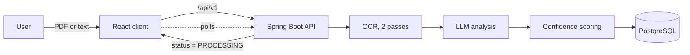

<div align="center">

# PostPrep

**An AI-driven blog post metadata extraction tool.**

Upload a PDF or paste raw text. Get back a title, summary, keywords, categories, an SEO title, the detected language, and a confidence score telling you how much to trust the result.


[Live demo (API)](https://aminesidki-postprep.hf.space) · [Backend](https://github.com/AmineSidki/PostPrep-Backend) · [Frontend](https://github.com/Hajar-ELHILALI/postprep-frontend)

</div>

> [!NOTE]
> This is the central repository for the PostPrep project. The code lives in two dedicated repositories:
>
> | Part | Repository | Stack |
> | ---- | ---------- | ----- |
> | Backend | [AmineSidki/PostPrep-Backend](https://github.com/AmineSidki/PostPrep-Backend) | Java 17, Spring Boot 3.4, PostgreSQL |
> | Frontend | [Hajar-ELHILALI/postprep-frontend](https://github.com/Hajar-ELHILALI/postprep-frontend) | React 18, Vite, TypeScript, Tailwind |

## Overview

Writing good metadata for a post (a title that fits, a faithful summary, relevant tags, an SEO title) is repetitive work. PostPrep automates it: it ingests a document, extracts its text (running OCR on scanned PDFs when needed), asks an LLM to produce structured metadata, and then **verifies that metadata against the source** so hallucinated or off-topic output gets flagged instead of silently accepted.

## Features

- **PDF and raw text input**, including scanned PDFs through a two-pass OCR pipeline.
- **Structured output**: title, summary (about 200 words), up to 6 keywords, categories, SEO title, and detected language.
- **Semantic confidence score**: every result is scored on how faithful it is to the original text.
- **Asynchronous processing**: uploads return immediately and the client polls until the article is `PROCESSED` or `INTERRUPTED`.
- **Multilingual OCR**: English and Arabic are recognised in the first pass, then the language is detected and the text is re-read with the matching model.
- **Accounts and roles**: JWT authentication over HttpOnly cookies, with `USER` and `ADMIN` roles.
- **Admin dashboard**: user and article management, plus daily and monthly usage statistics.
- **Prompt-injection guard**: source text is fenced in `<DATA_SOURCE>` tags and the model is instructed to ignore any instruction found inside it.

## How it works



1. **Ingest.** The upload creates an article in `PROCESSING` state and the API responds right away. The rest runs on a background thread.
2. **OCR (PDFs only).** Pages are rendered at 300 DPI and read by Tesseract. Pass 1 uses `eng+ara`, the language is then detected, and pass 2 re-runs OCR with the model for that language.
3. **LLM analysis.** The text is sent to `Qwen2.5-7B-Instruct` through the Hugging Face router with a strict JSON-only prompt. The reply is parsed defensively.
4. **Confidence scoring.** The metadata and the source chunks are embedded locally with `all-MiniLM-L6-v2`. The score is the mean of the top 3 cosine similarities between the metadata vector and the source chunks.
5. **Persist.** The article is saved as `PROCESSED`, or `INTERRUPTED` if any step failed.

## Architecture notes

- **Separate client and API.** The frontend is a single-page app that talks to the backend REST API under `/api/v1`.
- **Cookie-based auth.** Tokens are `HttpOnly` and `SameSite=Strict`, so the app and the API must be served from the same site. In development the Vite dev server proxies `/api` to the backend.
- **Role detection.** The API has no "who am I" endpoint, so the client probes an admin-only route after login to determine the role. Admin screens are code-split and only load for admins.
- **Local embeddings.** Confidence scoring runs on local ONNX embeddings, so verification does not depend on an external API.

## Tech stack

| Layer | Technologies |
| ----- | ------------ |
| Backend | Java 17, Spring Boot 3.4 (Web, Data JPA, Security, OAuth2 Resource Server), Spring AI |
| AI | Hugging Face router (`Qwen/Qwen2.5-7B-Instruct`), `all-MiniLM-L6-v2` embeddings (ONNX) |
| OCR | Tess4j (Tesseract), Apache PDFBox, optimaize language-detector |
| Database | PostgreSQL |
| Frontend | React 18, Vite, TypeScript, Tailwind CSS 3 |
| DevOps | Docker, GitHub Actions, Hugging Face Spaces (backend), Vercel (frontend) |

## Getting started

Run the backend first, then the frontend.

**1. Backend**

```bash
git clone https://github.com/AmineSidki/PostPrep-Backend.git
cd PostPrep-Backend
./RSA_keygen.sh
# set DB_URL, DB_USR, DB_PWD, HUGGINGFACE_API_KEY, PUBLIC_KEY, PRIVATE_KEY, TESSERACT_DIR
./mvnw spring-boot:run        # listens on :8080
```

Or with Docker:

```bash
docker build -t postprep .
docker run -p 8080:8080 --env-file .env postprep
```

**2. Frontend**

```bash
git clone https://github.com/Hajar-ELHILALI/postprep-frontend.git
cd postprep-frontend
npm install
npm run dev                   # proxies /api to the backend
```

Set `VITE_API_URL` to override the API base URL. Full prerequisites, environment variables, and API reference are in the [backend README](https://github.com/AmineSidki/PostPrep-Backend#readme).

## Deployment

- **Backend:** every push to `main` triggers a GitHub Actions workflow that syncs the repository to a Hugging Face Space, which builds the Docker image and serves it on port `8080`. Live at <https://aminesidki-postprep.hf.space>.
- **Frontend:** configured for Vercel.

## Team

| Contributor | Role |
| ----------- | ---- |
| [Amine Sidki](https://github.com/AmineSidki) | Backend: REST API, OCR and LLM pipeline, security, deployment |
| [Hajar El Hilali](https://github.com/Hajar-ELHILALI) | Frontend: React client, admin dashboard, UI design |
